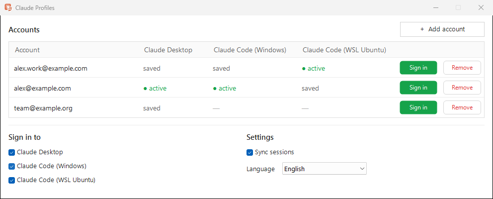

# Claude Profile Switcher

Switches Claude Desktop and Claude Code between several Claude accounts without signing in again.

[Русская версия](README.ru.md) · Unofficial tool, not affiliated with or endorsed by Anthropic. It is meant for switching between your own accounts (e.g. personal and work); follow the terms of service of your Claude plans.



## Supported

| App | Windows | Linux | macOS |
|---|---|---|---|
| Claude Desktop | yes (Microsoft Store and classic installer) | — | no |
| Claude Code | yes, Windows and every WSL distribution | yes, command line only | no |

Windows 10/11. No Python, WSL or administrator rights needed.

## Features

- Switch the selected apps to a saved account in one click.
- Each app keeps its own copy of every account's sign-in.
- Before a switch the current sign-in is saved, so switching back never asks you to sign in again.
- Add a new account: the app signs out and opens the normal Claude sign-in.
- Optional: share Claude Desktop Code sessions between accounts.

## Install

1. Download the [latest release](https://github.com/Ioprst/claude-profile-switcher/releases/latest) (or the [current version as a ZIP](https://github.com/Ioprst/claude-profile-switcher/archive/refs/heads/main.zip)) and unpack it.
2. In PowerShell, in that folder:
   ```powershell
   powershell -ExecutionPolicy Bypass -File install.ps1
   ```

The app is installed for the current user into `%LOCALAPPDATA%\ClaudeProfileSwitcher`, starts with Windows and runs in the tray. The downloaded folder can be deleted afterwards.

**Update:** download the new version and run `install.ps1` again.
**Uninstall:** Settings → Apps → Installed apps → Claude Profile Switcher, or `install.ps1 -Uninstall`.

## Usage

1. Open the app: click the tray icon or use the desktop shortcut.
2. Under **Sign in to**, tick the apps to switch.
3. **Add account** — enter the account's e-mail and sign in to Claude in the window that opens.
4. **Sign in** next to an account switches to it. The tray menu (right click) does the same.

**Sync sessions** (settings): after a Claude Desktop switch, Code sessions started under other saved accounts are available too.

**Language** (settings): English or Russian; by default the language of Windows.

## Limitations

- Switching Claude Desktop restarts it; Code sessions running inside it are interrupted.
- Claude Desktop's sign-in is saved on the first switch, not at install time.
- Claude Code sessions already running in a terminal keep their account, and one of them may write its old account back into `.claude.json`. Close running Claude Code sessions before a switch.
- When you add an account, the next Claude Desktop sign-in is saved under the e-mail you entered. Sign in with that same account.
- A WSL distribution that is not running is shown as "WSL not running": the app does not start it just to look. Switching it starts it.
- An account that is signed in somewhere cannot be removed; switch to another account first.
- Works by copying the apps' local files; an update of Claude can break it.

## Linux (command line)

```bash
python3 claude_profiles.py status                          # apps, saved profiles
python3 claude_profiles.py switch you@example.com          # switch everything saved for this account
python3 claude_profiles.py logout --target code            # sign out, then: claude auth login
python3 claude_profiles.py remove you@example.com
python3 claude_profiles.py set language en                # settings: sync-sessions on|off, language auto|en|ru
```

## Data

- Saved sign-ins: `%USERPROFILE%\.claude-profiles` (`~/.claude-profiles` on Linux). Tokens are stored as plain files, like Claude Code does itself. Uninstalling keeps this folder.
- Claude Desktop sign-ins are encrypted by Windows and work only for the same Windows user.
- Network is used only once, to download Python from python.org during install.
- More in [SECURITY.md](SECURITY.md); changes in [CHANGELOG.md](CHANGELOG.md).

## License

[MIT](LICENSE)
