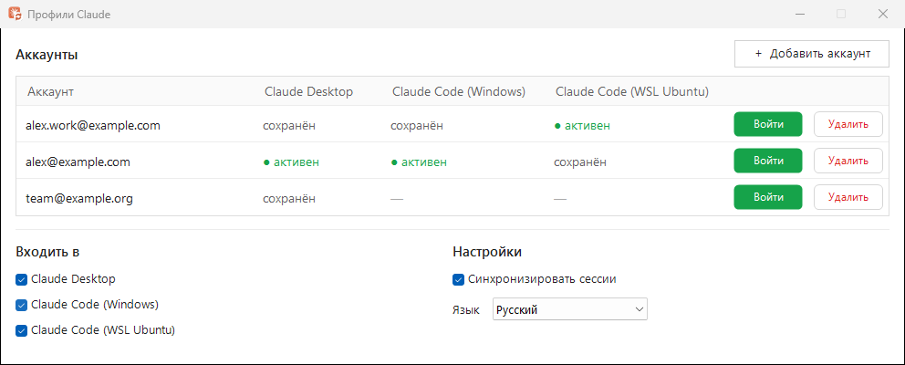

# Claude Profile Switcher

Переключает Claude Desktop и Claude Code между несколькими аккаунтами Claude без повторного входа.

[English version](README.md) · Неофициальный инструмент, не связан с Anthropic и не одобрен ею. Предназначен для переключения между вашими собственными аккаунтами (например, личным и рабочим); соблюдайте условия использования ваших тарифов Claude.



## Что поддерживается

| Приложение | Windows | Linux | macOS |
|---|---|---|---|
| Claude Desktop | да (Microsoft Store и обычный установщик) | — | нет |
| Claude Code | да, в Windows и в каждом дистрибутиве WSL | да, только из командной строки | нет |

Windows 10/11. Python, WSL и права администратора не нужны.

## Возможности

- Переключение выбранных приложений на сохранённый аккаунт в один клик.
- Для каждого приложения хранится своя копия входа каждого аккаунта.
- Перед переключением текущий вход сохраняется, поэтому при возврате на аккаунт входить заново не нужно.
- Добавление нового аккаунта: приложение выходит из текущего и открывает обычный вход Claude.
- По желанию: общие сессии Code в Claude Desktop для всех аккаунтов.

## Установка

1. Скачайте [последний релиз](https://github.com/Ioprst/claude-profile-switcher/releases/latest) (или [текущую версию ZIP-архивом](https://github.com/Ioprst/claude-profile-switcher/archive/refs/heads/main.zip)) и распакуйте.
2. В PowerShell в этой папке выполните:
   ```powershell
   powershell -ExecutionPolicy Bypass -File install.ps1
   ```

Приложение ставится для текущего пользователя в `%LOCALAPPDATA%\ClaudeProfileSwitcher`, запускается вместе с Windows и работает в трее. Скачанную папку после установки можно удалить.

**Обновление:** скачайте новую версию и снова запустите `install.ps1`.
**Удаление:** Параметры → Приложения → Установленные приложения → Claude Profile Switcher или `install.ps1 -Uninstall`.

## Как пользоваться

1. Откройте приложение: клик по значку в трее или ярлык на рабочем столе.
2. В блоке **Входить в** отметьте приложения, которые нужно переключать.
3. **Добавить аккаунт** — введите почту аккаунта и войдите в Claude в открывшемся окне.
4. **Войти** рядом с аккаунтом переключает на него. То же делает меню трея (правый клик).

**Синхронизировать сессии** (настройки): после переключения Claude Desktop доступны и сессии Code, начатые под другими сохранёнными аккаунтами.

**Язык** (настройки): английский или русский; по умолчанию — как в Windows.

## Ограничения

- При переключении Claude Desktop перезапускается; запущенные в нём сессии Code прерываются.
- Вход Claude Desktop сохраняется при первом переключении, а не при установке.
- Уже запущенные в терминале сессии Claude Code остаются под своим аккаунтом и могут записать старый аккаунт обратно в `.claude.json`. Перед переключением закройте запущенные сессии Claude Code.
- При добавлении аккаунта следующий вход в Claude Desktop сохраняется под введённой почтой. Входите именно в этот аккаунт.
- Незапущенный дистрибутив WSL показывается как «WSL не запущен»: приложение не запускает его ради проверки. Переключение его запускает.
- Аккаунт, под которым сейчас выполнен вход, удалить нельзя — сначала переключитесь на другой.
- Работает через копирование локальных файлов приложений; обновление Claude может это сломать.

## Linux (командная строка)

```bash
python3 claude_profiles.py status                          # приложения и сохранённые профили
python3 claude_profiles.py switch you@example.com          # переключить всё, что сохранено для аккаунта
python3 claude_profiles.py logout --target code            # выйти, затем: claude auth login
python3 claude_profiles.py remove you@example.com
python3 claude_profiles.py set language ru                # настройки: sync-sessions on|off, language auto|en|ru
```

## Данные

- Сохранённые входы: `%USERPROFILE%\.claude-profiles` (`~/.claude-profiles` в Linux). Токены хранятся обычными файлами, как их хранит сам Claude Code. При удалении приложения папка остаётся.
- Входы Claude Desktop зашифрованы Windows и работают только у того же пользователя Windows.
- Сеть используется один раз — скачать Python с python.org при установке.
- Подробнее — в [SECURITY.md](SECURITY.md), изменения — в [CHANGELOG.md](CHANGELOG.md).

## Лицензия

[MIT](LICENSE)
